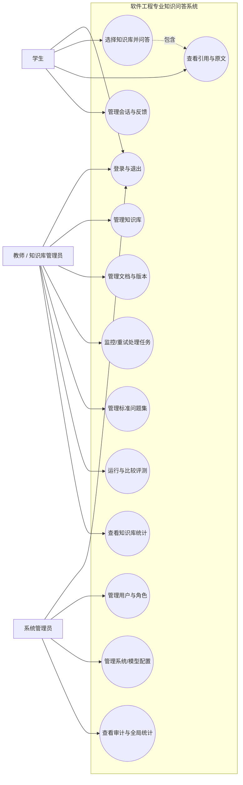
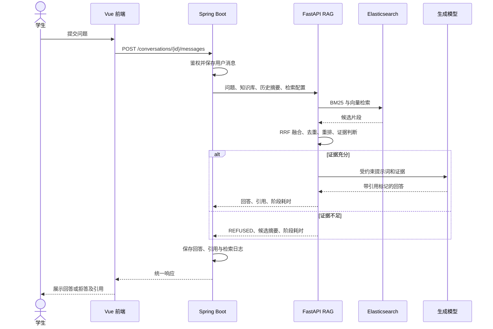

# 用例模型

## 1. 系统用例图

## 2. 权限矩阵

符号：`R` 查看，`C` 创建，`U` 修改，`D` 删除/下架，`X` 执行。

| 资源/操作 | 学生 | 教师/知识库管理员 | 系统管理员 |
|---|---|---|---|
| 已发布知识库 | R | R（授权范围） | R |
| 知识库配置 | - | C/U/D（授权范围） | C/R/U/D |
| 文档与版本 | R（仅引用） | C/R/U/D（授权范围） | R/D |
| 处理任务 | - | R/X（授权范围） | R/X |
| 本人会话 | C/R/U/D | C/R/U/D | 仅审计元数据 |
| 他人会话正文 | - | - | 默认禁止 |
| 回答反馈 | C/R/U | R（授权知识库） | R |
| 标准问题与评测 | - | C/R/U/D/X（授权范围） | R/X |
| 用户与角色 | - | - | C/R/U/D |
| 模型配置 | - | - | C/R/U/D/X |
| 审计日志 | - | - | R |

## 3. 详细用例

### UC-01 用户登录

- **参与者**：所有用户。
- **前置条件**：账号存在且未停用。
- **触发**：用户提交账号和密码。
- **主流程**：校验参数；查询账号；验证密码哈希；签发短期访问令牌和可撤销刷新令牌；记录成功日志；返回用户及权限摘要。
- **异常流程**：凭据错误统一提示；账号停用返回禁止登录；连续失败达到阈值后短时限流；系统异常只返回关联 ID。
- **后置条件**：成功时产生有效登录会话；失败时不泄露账号是否存在。

### UC-02 创建知识库并发布

- **参与者**：教师/知识库管理员。
- **前置条件**：已登录，具有创建或管理权限。
- **主流程**：录入课程、名称、说明和访问范围；系统校验唯一性并保存草稿；管理员上传并成功处理至少一份文档；执行发布；系统确认存在可检索内容后变更为已发布并记录审计。
- **异常流程**：名称冲突；无可用文档；用户无该知识库权限；并发修改版本冲突。
- **后置条件**：学生可以看到并选择已发布知识库。

### UC-03 上传并处理文档

- **参与者**：教师/知识库管理员。
- **前置条件**：对目标知识库有管理权。
- **主流程**：选择文件并填写分类；服务端校验扩展名、MIME、大小和文件名；流式计算 SHA-256；重复检测；保存文件与版本元数据；创建异步任务；依次抽取、清洗、切片、向量化和建索引；状态变为 `READY`。
- **异常流程**：格式不支持、空/超限/损坏文件；重复内容；解析器异常；Embedding 或 Elasticsearch 不可用。失败任务保存步骤和脱敏原因，可人工重试。
- **后置条件**：成功片段可检索；失败任务不会被发布。

### UC-04 学生进行多轮问答

- **参与者**：学生。
- **前置条件**：已登录；知识库已发布且可访问。
- **主流程**：创建或进入会话；提交问题；系统保存用户消息；结合有限历史改写检索问题；并行执行 BM25 和向量检索；融合去重并按配置重排；校验证据；生成受证据约束的回答；保存回答、引用、检索日志和耗时；返回结果。
- **替代流程**：证据不足时保存并返回 `REFUSED`，内容为“当前知识库没有足够依据回答该问题”。
- **异常流程**：请求过快、知识库下架、检索服务不可用、模型超时。系统保存失败类别并允许重试，不生成伪答案。
- **后置条件**：结果可从历史会话重现，引用关联当次实际证据。

### UC-05 查看引用原文

- **参与者**：学生、教师。
- **前置条件**：有权查看引用所属知识库和会话。
- **主流程**：用户点击引用编号；系统校验资源权限；返回文档名、版本、章节、页码、片段正文及前后有限上下文；界面高亮对应片段。
- **异常流程**：文档已下架时允许历史审计查看但明确标记；文件已受控清理时仍展示生成时保存的引用快照。

### UC-06 提交答案反馈

- **参与者**：学生。
- **前置条件**：回答属于本人可见会话。
- **主流程**：选择有帮助或无帮助；可选择引用错误、内容不完整、疑似错误等标签并填写意见；系统新增或更新本人当前反馈；统计异步更新。
- **异常流程**：意见超长或包含非法参数时拒绝；不得修改他人反馈。

### UC-07 重试文档处理任务

- **参与者**：教师/知识库管理员、系统管理员。
- **前置条件**：任务为 `FAILED`，操作者有目标知识库权限。
- **主流程**：查看失败阶段与原因；发起重试；系统通过幂等键确认没有活动任务；清理该版本未完成索引；创建新尝试并从安全阶段重新处理；记录审计。
- **异常流程**：依赖服务仍不可用；任务已被其他请求重试；文档已删除或下架。

### UC-08 批量运行效果评测

- **参与者**：教师/知识库管理员。
- **前置条件**：标准问题集有效，知识库存在就绪索引。
- **主流程**：选择题集、检索方案和模型配置；系统冻结配置快照；逐题运行并保存候选、回答、引用、耗时和错误；计算自动指标；人工补充正确性、完整性与引用评分；查看和导出对比结果。
- **异常流程**：运行中依赖失败时记录单题错误并允许从未完成题继续；不得把缺失结果按零以外的规则静默处理。
- **后置条件**：总指标可由逐题记录复算，论文图表可追溯到运行 ID。

### UC-09 管理用户与角色

- **参与者**：系统管理员。
- **前置条件**：管理员已通过认证。
- **主流程**：创建/导入用户；分配角色；启停账号；必要时重置密码；每项变更写入审计日志。
- **异常流程**：用户名冲突；删除最后一个有效管理员；管理员尝试读取用户密码。

### UC-10 配置并检测模型

- **参与者**：系统管理员。
- **前置条件**：模型端点和密钥已通过环境变量或安全配置注入。
- **主流程**：选择模型类型和非敏感参数；保存配置；执行连接测试；返回延迟和能力信息；设置启用版本。
- **异常流程**：接口不可达、认证失败、维度不匹配、模型响应超时。返回脱敏错误，旧配置继续生效。

## 4. 核心活动流程

