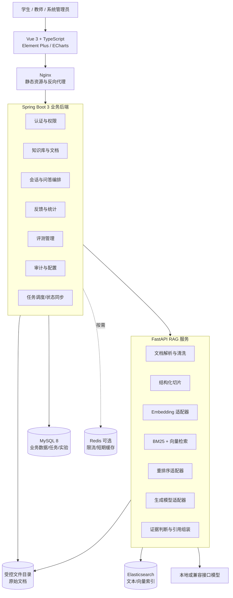
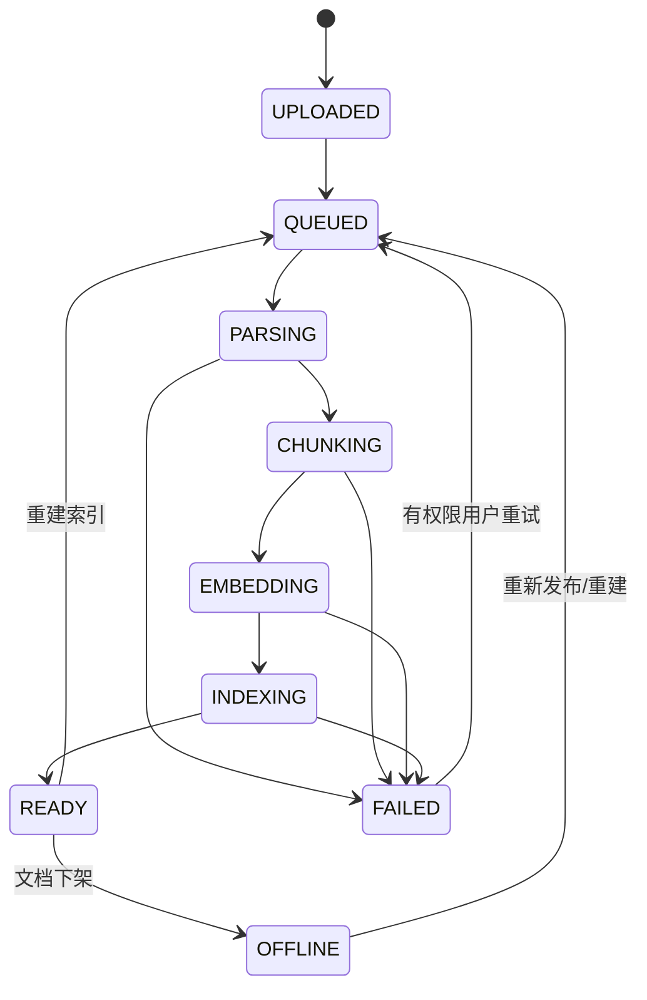
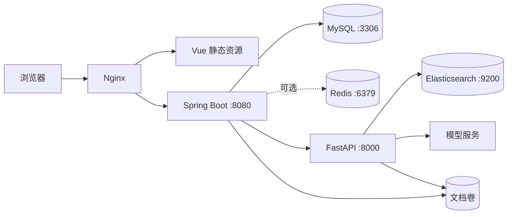

# 系统架构与模块设计

版本：0.1（总体设计草案）

## 1. 架构目标

系统采用前后端分离和业务/RAG 服务分离架构，优先保证权限边界、来源可追溯、处理任务可恢复、模型可替换以及实验可复现。首期按模块化单体部署 Spring Boot 业务后端，避免为毕业设计规模引入不必要的微服务治理复杂度。

## 2. 总体架构

## 3. 服务职责与边界

### 3.1 Vue 前端

- 展示登录、问答、引用、文档、任务、评测和统计界面。
- 维护纯展示状态和短期交互状态，不在浏览器保存模型密钥。
- 依据权限隐藏不可用入口，但最终授权必须由后端执行。
- 对上传、索引和问答显示明确的加载、失败、重试和空状态。

### 3.2 Spring Boot 业务后端

- 作为浏览器唯一业务 API 入口，负责认证、RBAC 和知识库级数据权限。
- 管理用户、知识库、文档版本、任务、会话、反馈、评测和审计数据。
- 编排 RAG 服务调用，保存请求配置快照、回答、引用和检索日志。
- 控制文件上传与下载，禁止客户端直接访问磁盘路径。
- 不实现模型算法，但负责超时、幂等、事务和错误映射。

### 3.3 FastAPI RAG 服务

- 提供内部接口，不直接面向终端用户。
- 解析、清洗、切片文档，生成向量并写入/删除检索索引。
- 执行向量检索、BM25、RRF 融合、去重、可选重排和证据判断。
- 通过统一适配器调用 Embedding、Reranker 和 Chat Model。
- 返回结构化证据、分数和阶段耗时，不决定业务权限。

### 3.4 数据组件

- MySQL 是业务状态的唯一事实来源；Redis 不承担不可恢复的唯一数据。
- Elasticsearch 是可重建索引，索引记录必须带知识库、文档版本和发布状态字段。
- 原始文件使用系统生成的存储键，不直接以用户文件名作为磁盘路径。

## 4. 业务后端模块

| 模块 | 主要职责 | 依赖 |
|---|---|---|
| `auth` | 登录、令牌刷新、退出、密码哈希、当前用户 | user、role、Redis（可选） |
| `user` | 用户、角色、账号状态 | audit |
| `knowledgebase` | 知识库、成员授权、发布状态、检索配置 | document、audit |
| `document` | 上传校验、哈希、版本、文件访问、上下架 | storage、ingestion |
| `ingestion` | 任务状态机、重试、调用 RAG 服务 | document、rag-client |
| `conversation` | 会话、消息、回答版本、引用 | rag-client、retrieval-log |
| `feedback` | 回答反馈与标签 | conversation |
| `evaluation` | 题集、运行、逐题结果、自动/人工指标 | rag-client |
| `analytics` | 统计口径与聚合查询 | feedback、retrieval-log |
| `audit` | 操作审计与敏感字段脱敏 | 全局事件 |
| `config` | 非敏感系统配置、模型配置引用 | audit |

模块之间通过应用服务或明确事件交互，不跨模块直接修改对方数据表。

## 5. RAG 服务模块

| 模块 | 输入 | 输出/职责 |
|---|---|---|
| `parser` | 文件路径、MIME、版本 ID | 页/段落/标题层级及抽取警告 |
| `cleaner` | 原始文本块 | 规范化文本，保留原位置映射 |
| `chunker` | 结构化正文、切片参数 | chunk、重叠、token/字符数和来源元数据 |
| `embedding` | 文本列表、模型配置 | 固定维度向量和模型版本 |
| `indexer` | chunk、向量、过滤字段 | 索引写入/删除结果 |
| `retriever` | 问题、知识库、topK | BM25 与向量候选及原始排名 |
| `fusion` | 两路候选、RRF 参数 | 去重后的融合排名 |
| `reranker` | 问题、候选、topN | 相关性重排结果 |
| `evidence` | 候选、阈值、覆盖规则 | `SUFFICIENT` 或 `INSUFFICIENT` 及理由 |
| `generator` | 系统约束、问题、证据、历史摘要 | 回答文本和引用标记 |

首版 RRF 分数定义为：

\[
score(d)=\sum_{r \in R}\frac{w_r}{k+rank_r(d)}
\]

其中 `R` 为 BM25 与向量结果集合，`k` 初始取 60，`w_r` 初始相同。参数仅为初始值，最终通过标准问题集实验确定。

## 6. 关键流程

### 6.1 文档处理状态机

每次尝试创建独立 `ingestion_task`，通过 `(document_version_id, active_flag)` 或应用层锁避免同版本并行处理。索引写入使用确定性 chunk ID，重复执行应覆盖同一版本而非制造重复记录。

### 6.2 问答流程

1. Spring Boot 校验用户、会话和知识库权限并保存问题。
2. 使用最近有限轮次生成独立检索问题；改写失败时回退原问题。
3. FastAPI 并行执行 BM25 和向量检索，仅过滤到当前知识库的已发布版本。
4. 执行 RRF、内容哈希去重和可选重排序，保存各阶段名次与耗时。
5. 证据门控综合最高相关分、有效片段数和问题覆盖度；阈值由验证集确定。
6. 证据不足直接返回拒答，不调用生成模型；证据充分时生成回答。
7. 校验回答引用编号只能引用输入证据；保存回答、引用快照与检索日志。

### 6.3 删除与下架

下架优先于物理删除：先阻止新检索，再更新 Elasticsearch 过滤状态或删除对应版本索引，最后按保留策略清理文件。任何一步失败均保留可重试任务和审计记录。历史回答保留引用快照，避免来源展示完全丢失。

## 7. 安全设计

- 访问令牌短有效期，刷新令牌存储摘要并支持撤销；密码使用 BCrypt 或 Argon2。
- 后端使用“角色 + 资源归属”双重校验，禁止仅依赖前端菜单权限。
- 上传文件校验扩展名、MIME、大小、空文件和内容哈希；存储路径由服务端生成。
- 文件名展示前编码；下载接口设置安全的 `Content-Disposition`。
- 文档内容放入明确的数据边界，提示词声明其不可信，任何文档指令不得覆盖系统指令。
- 日志不记录密码、令牌、API Key、完整系统提示词和不必要的文档正文。
- 内部 RAG 接口使用服务凭据或受限网络，不暴露给公网。

## 8. 可观测性与错误处理

- 入口生成 `traceId`，Spring Boot 调用 FastAPI 时透传。
- 指标至少包括请求量、错误率、P50/P95 耗时、检索阶段耗时、拒答数、任务失败数和模型 token 用量（若可得）。
- 业务错误使用稳定错误码；异常堆栈只写服务日志，不返回浏览器。
- 检索、重排和生成分别设置超时；生成超时不能把空答案保存为成功。

## 9. 部署拓扑

开发环境可直接运行各组件；验收环境优先使用 Docker Compose 固化服务版本。数据库、索引、上传目录和模型缓存必须映射到 `D:\毕业设计` 下的明确目录，未经允许不得下载到 C 盘。

## 10. 待原型验证

1. 当前机器运行 Elasticsearch、MySQL、后端和模型时的内存占用。
2. 中文 Embedding 模型在 CPU/现有 GPU 上的吞吐和向量维度。
3. Elasticsearch 所用版本对目标向量检索语法和中文分词插件的支持。
4. 本地模型与兼容 API 两种方案的答辩稳定性。
5. Redis 是否必要；若只做低并发本科演示，可先用数据库任务表与本地限流实现。

