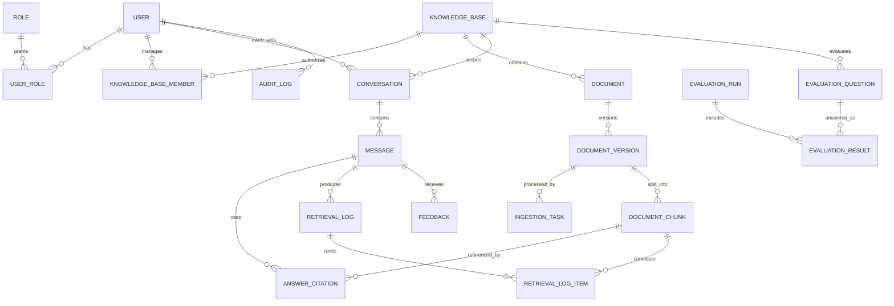

# 数据库设计

版本：0.1（逻辑模型）  
数据库：MySQL 8，字符集 `utf8mb4`，时区由应用统一配置为 `Asia/Shanghai`，接口时间使用 ISO 8601。

## 1. 设计原则

- 主键使用 64 位整数（雪花 ID 或服务端 ID 生成器），不向业务表达顺序含义。
- 所有核心表包含 `created_at`、`updated_at`；需要逻辑删除的表增加 `deleted_at`。
- 状态使用受控字符串或小整数并由应用枚举校验，文档中使用可读字符串表示。
- 密码、令牌和模型密钥不以明文存储；API Key 只保存密文或外部 secret 引用。
- 回答、引用和评测保存配置快照，确保实验和历史结果可追溯。
- Elasticsearch 可重建；MySQL 保存索引元数据、任务和实验事实。

## 2. ER 图

## 3. 公共字段约定

| 字段 | 类型 | 说明 |
|---|---|---|
| `id` | BIGINT | 主键 |
| `created_at` | DATETIME(3) | 创建时间 |
| `updated_at` | DATETIME(3) | 最后更新时间 |
| `created_by` | BIGINT NULL | 创建用户，系统任务可为空 |
| `deleted_at` | DATETIME(3) NULL | 非空表示逻辑删除 |
| `version` | INT | 乐观锁版本号，用于高冲突资源 |

## 4. 数据字典

### 4.1 用户与权限

#### `user`

| 字段 | 类型 | 约束/说明 |
|---|---|---|
| `id` | BIGINT | PK |
| `username` | VARCHAR(64) | NOT NULL，唯一，登录名 |
| `password_hash` | VARCHAR(255) | NOT NULL，BCrypt/Argon2 哈希 |
| `display_name` | VARCHAR(64) | NOT NULL |
| `email` | VARCHAR(255) | NULL，可选唯一 |
| `status` | VARCHAR(16) | `ACTIVE`、`DISABLED`、`LOCKED` |
| `last_login_at` | DATETIME(3) | NULL |
| `created_at/updated_at/deleted_at` | DATETIME(3) | 审计字段 |

索引：`uk_user_username(username, deleted_at)`；`idx_user_status(status)`。若 MySQL 对含 NULL 唯一索引不满足逻辑删除需求，应增加持久生成列或不复用用户名。

#### `role`

字段：`id`、`code VARCHAR(32) UNIQUE`、`name VARCHAR(64)`、`description VARCHAR(255)`、审计字段。预置角色为 `STUDENT`、`KB_ADMIN`、`SYS_ADMIN`。

#### `user_role`

字段：`user_id BIGINT`、`role_id BIGINT`、`created_at`、`created_by`。联合主键 `(user_id, role_id)`。

#### `refresh_token`

字段：`id`、`user_id`、`token_hash CHAR(64) UNIQUE`、`expires_at`、`revoked_at`、`device_info VARCHAR(255)`、`created_at`。只保存令牌摘要。

### 4.2 知识库与文档

#### `knowledge_base`

| 字段 | 类型 | 约束/说明 |
|---|---|---|
| `id` | BIGINT | PK |
| `code` | VARCHAR(64) | 唯一稳定编码 |
| `name` | VARCHAR(128) | NOT NULL |
| `course_name` | VARCHAR(128) | NOT NULL |
| `description` | TEXT | 说明 |
| `visibility` | VARCHAR(16) | `PUBLIC`、`RESTRICTED` |
| `status` | VARCHAR(16) | `DRAFT`、`PUBLISHED`、`OFFLINE` |
| `retrieval_config_json` | JSON | topK、RRF、重排和证据阈值 |
| `published_at` | DATETIME(3) | NULL |
| 公共字段 | | 含 `version` 与逻辑删除 |

索引：`uk_kb_code(code)`、`idx_kb_status(status, visibility)`。

#### `knowledge_base_member`

字段：`knowledge_base_id`、`user_id`、`member_role VARCHAR(16)`（首期为 `MANAGER`）、`created_by`、`created_at`。联合主键 `(knowledge_base_id, user_id)`。

#### `document`

字段：`id`、`knowledge_base_id`、`title VARCHAR(255)`、`category VARCHAR(64)`、`status VARCHAR(16)`（`DRAFT/PUBLISHED/OFFLINE`）、`current_version_id BIGINT NULL`、公共字段。索引：`idx_document_kb_status(knowledge_base_id,status,deleted_at)`。

#### `document_version`

| 字段 | 类型 | 约束/说明 |
|---|---|---|
| `id` | BIGINT | PK |
| `document_id` | BIGINT | FK |
| `version_no` | INT | 同文档递增 |
| `original_filename` | VARCHAR(255) | 仅展示，不能拼磁盘路径 |
| `storage_key` | VARCHAR(512) | 系统生成的相对存储键 |
| `media_type` | VARCHAR(128) | 服务端检测值 |
| `extension` | VARCHAR(16) | 规范化扩展名 |
| `file_size` | BIGINT | 字节数 |
| `sha256` | CHAR(64) | 内容摘要 |
| `page_count` | INT | NULL，解析后回填 |
| `parse_status` | VARCHAR(16) | 文档总体处理状态 |
| `parser_name/version` | VARCHAR(64) | 解析器追踪信息 |
| `created_at/created_by` | | 不物理覆盖历史版本 |

约束/索引：`UNIQUE(document_id, version_no)`；`idx_docver_hash(document_id, sha256)`；`idx_docver_status(parse_status)`。

#### `ingestion_task`

字段：`id`、`document_version_id`、`task_type VARCHAR(24)`、`status VARCHAR(16)`、`current_stage VARCHAR(24)`、`attempt_no INT`、`progress_percent TINYINT`、`config_snapshot_json JSON`、`error_code VARCHAR(64)`、`error_message VARCHAR(1000)`、`trace_id VARCHAR(64)`、`started_at`、`finished_at`、`created_at`、`updated_at`。索引：`idx_task_version_status(document_version_id,status)`、`idx_task_status_created(status,created_at)`。

#### `document_chunk`

字段：`id`、`document_version_id`、`chunk_no INT`、`content MEDIUMTEXT`、`content_hash CHAR(64)`、`heading_path VARCHAR(1000)`、`page_start INT NULL`、`page_end INT NULL`、`char_count INT`、`token_count INT NULL`、`embedding_model VARCHAR(128)`、`index_name VARCHAR(128)`、`index_doc_id VARCHAR(128)`、`created_at`。约束：`UNIQUE(document_version_id, chunk_no)`；索引：`idx_chunk_hash(document_version_id,content_hash)`。

> 首期在 MySQL 保存片段正文用于引用审计；若数据规模扩大，可改为正文快照/对象存储并在 MySQL 保留摘要和定位信息。

### 4.3 会话、检索与反馈

#### `conversation`

字段：`id`、`user_id`、`knowledge_base_id`、`title VARCHAR(128)`、`status VARCHAR(16)`、`last_message_at`、公共字段。索引：`idx_conv_user_time(user_id,deleted_at,last_message_at)`。

#### `message`

| 字段 | 类型 | 说明 |
|---|---|---|
| `id` | BIGINT | PK |
| `conversation_id` | BIGINT | FK |
| `parent_message_id` | BIGINT NULL | 重生成/分支来源 |
| `role` | VARCHAR(16) | `USER`、`ASSISTANT` |
| `content` | MEDIUMTEXT | 问题或回答 |
| `rewritten_query` | TEXT NULL | 用户消息对应的检索改写 |
| `answer_status` | VARCHAR(16) NULL | `ANSWERED/REFUSED/FAILED` |
| `answer_version` | INT NULL | 同问题回答版本 |
| `model_name` | VARCHAR(128) NULL | 生成模型版本 |
| `latency_ms` | INT NULL | 总耗时 |
| `error_code` | VARCHAR(64) NULL | 失败分类 |
| `config_snapshot_json` | JSON NULL | 生成时配置 |
| `created_at` | DATETIME(3) | |

索引：`idx_message_conv_time(conversation_id,created_at)`；重生成使用 `(parent_message_id, answer_version)` 唯一约束。

#### `answer_citation`

字段：`id`、`message_id`、`document_chunk_id`、`citation_no INT`、`quote_text TEXT`、`document_title_snapshot VARCHAR(255)`、`heading_snapshot VARCHAR(1000)`、`page_start/page_end INT NULL`、`retrieval_score DECIMAL(12,8)`、`created_at`。约束：`UNIQUE(message_id,citation_no)`。

#### `retrieval_log`

字段：`id`、`message_id`、`query_text TEXT`、`method VARCHAR(32)`、`top_k INT`、`candidate_count INT`、`evidence_status VARCHAR(16)`、`evidence_reason VARCHAR(255)`、`bm25_ms/vector_ms/rerank_ms/total_ms INT`、`config_snapshot_json JSON`、`trace_id`、`created_at`。

#### `retrieval_log_item`

字段：`id`、`retrieval_log_id`、`document_chunk_id`、`source VARCHAR(16)`、`bm25_rank/vector_rank/fusion_rank/rerank_rank INT NULL`、`bm25_score/vector_score/fusion_score/rerank_score DECIMAL(14,8) NULL`、`selected_as_evidence BOOLEAN`。索引：`idx_ret_item_log_rank(retrieval_log_id,fusion_rank)`。

#### `feedback`

字段：`id`、`message_id`、`user_id`、`helpful BOOLEAN`、`citation_error BOOLEAN`、`incomplete BOOLEAN`、`suspected_error BOOLEAN`、`comment VARCHAR(1000)`、`created_at`、`updated_at`。约束：`UNIQUE(message_id,user_id)`。

### 4.4 评测、配置与审计

#### `evaluation_question`

字段：`id`、`knowledge_base_id`、`question_code VARCHAR(32)`、`question TEXT`、`reference_answer MEDIUMTEXT`、`reference_document VARCHAR(255)`、`reference_section VARCHAR(255)`、`reference_pages VARCHAR(64)`、`evidence_text MEDIUMTEXT`、`question_type VARCHAR(32)`、`should_refuse BOOLEAN`、`review_status VARCHAR(16)`、`reviewed_by BIGINT NULL`、公共字段。约束：`UNIQUE(knowledge_base_id,question_code)`。

#### `evaluation_run`

字段：`id`、`name VARCHAR(128)`、`knowledge_base_id`、`status VARCHAR(16)`、`retrieval_method VARCHAR(32)`、`config_snapshot_json JSON`、`question_count INT`、`completed_count INT`、`metrics_json JSON`、`started_at`、`finished_at`、`created_by`、`created_at`。运行开始后配置快照不可变。

#### `evaluation_result`

字段：`id`、`evaluation_run_id`、`evaluation_question_id`、`status VARCHAR(16)`、`generated_answer MEDIUMTEXT`、`retrieved_chunk_ids_json JSON`、`citation_snapshot_json JSON`、`recall_at_5 DECIMAL(6,5)`、`reciprocal_rank DECIMAL(6,5)`、`refusal_correct BOOLEAN NULL`、`answer_correctness TINYINT NULL`、`completeness TINYINT NULL`、`citation_accuracy TINYINT NULL`、`latency_ms INT`、`error_code`、`reviewer_id BIGINT NULL`、`review_comment VARCHAR(1000)`、`created_at/updated_at`。约束：`UNIQUE(evaluation_run_id,evaluation_question_id)`。

#### `system_config`

字段：`id`、`config_key VARCHAR(128) UNIQUE`、`config_value_json JSON`、`is_sensitive BOOLEAN`、`secret_ref VARCHAR(255) NULL`、`description VARCHAR(255)`、`version`、审计字段。敏感值不得出现在 `config_value_json`。

#### `audit_log`

字段：`id`、`actor_user_id NULL`、`action VARCHAR(64)`、`resource_type VARCHAR(64)`、`resource_id VARCHAR(64)`、`result VARCHAR(16)`、`client_ip VARCHAR(64)`、`user_agent VARCHAR(512)`、`trace_id VARCHAR(64)`、`detail_json JSON`、`created_at`。索引：`idx_audit_actor_time(actor_user_id,created_at)`、`idx_audit_resource(resource_type,resource_id,created_at)`。

## 5. Elasticsearch 索引映射要点

每个 chunk 文档至少包含：

| 字段 | 类型 | 用途 |
|---|---|---|
| `chunk_id` | keyword | 与 MySQL 片段关联 |
| `knowledge_base_id` | keyword | 强制权限/范围过滤 |
| `document_id` / `document_version_id` | keyword | 文档过滤和索引删除 |
| `document_status` | keyword | 只检索已发布内容 |
| `title` / `heading_path` | text + keyword | BM25 与展示 |
| `content` | text | 中文 BM25 检索 |
| `content_vector` | dense_vector | kNN 向量检索，维度由模型确定 |
| `page_start/page_end` | integer | 引用定位 |
| `content_hash` | keyword | 去重 |
| `embedding_model` | keyword | 防止模型/维度混用 |

索引别名指向带版本号的实际索引。Embedding 模型或映射变更时新建索引并完成全量重建，验证后原子切换别名。

## 6. 一致性与事务边界

1. 用户、知识库、会话等纯业务写入使用单库事务。
2. 文件保存、数据库和 Elasticsearch 无法使用同一事务，采用任务状态 + 幂等操作 + 补偿清理实现最终一致。
3. 上传时先写临时区并计算哈希，数据库提交后再进入正式存储键；失败临时文件由受控清理任务删除。
4. 问答先保存用户消息，再调用 RAG；成功后在事务中保存回答、引用和检索摘要，失败保存明确失败消息。
5. 评测运行的逐题结果独立提交，单题失败不回滚整个运行。

## 7. 数据保留与备份（待确认）

- 审计日志建议至少保留一个毕业设计完整周期。
- 被删除会话默认逻辑删除，具体保留天数待用户/学校确认。
- 原始文档、MySQL 备份和 Elasticsearch 快照必须采用一致的版本标签。
- 评测原始结果和配置快照属于论文实验依据，项目完成前不得只保留汇总指标。
